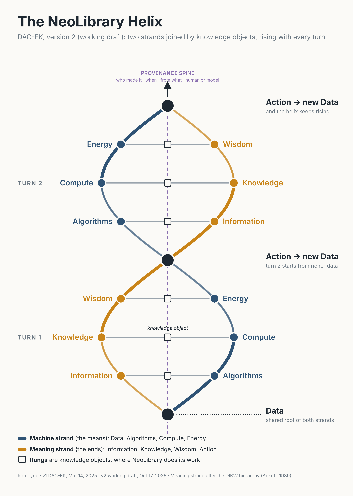

# Framework: DAC-EK and the NeoLibrary Helix

## Versions

Only two versions exist. Variants explored on the way (loops, a Y-loop) are steps inside v2, not versions of their own.

| Version | Date | Name | Status |
|---|---|---|---|
| v1 | March 14, 2025 | DAC-EK | Published |
| v2 | October 17, 2026 | NeoLibrary Helix | Working draft |

## v1: DAC-EK

Five resources every knowledge system consumes:

- **Data**: the raw material.
- **Algorithms**: the methods applied to it.
- **Compute**: the machinery that runs the methods.
- **Energy**: what the machinery costs to run.
- **Knowledge**: what comes out, and what feeds the next round.

Developed by Rob Tyrie in thinking sessions on March 14, 2025.

## v2: the NeoLibrary Helix (working draft)

v1 named the inputs but treated Knowledge as one bucket. v2 splits the output side into a full strand and winds both strands together.

- **Machine strand:** Data, Algorithms, Compute, Energy.
- **Meaning strand:** Information, Knowledge, Wisdom, Action. Builds on Ackoff's DIKW hierarchy (1989), extended with Action.
- **Rungs:** knowledge objects. Each rung is a concrete artifact that joins a machine step to a meaning step.
- **Crossings:** where Action produces new Data, so the structure climbs rather than loops.
- **Provenance spine:** runs up the centre. Every rung records what it was made from.

Source file: [images/neolibrary-helix-v2-draft.svg](images/neolibrary-helix-v2-draft.svg).

## Open questions for v2

1. Rung pairings. Draft: Algorithms with Information, Compute with Knowledge, Energy with Wisdom. Confirm or change.
2. Does Action sit at the crossings, or as its own rung?
3. 2D diagram or a 3D rendering for the published version?
4. One-line definition of a **wisdom object** to sit beside the knowledge object definition.

## Terms

| Term | Working definition |
|---|---|
| Knowledge object | A unit of synthesized knowledge with its content, its sources, and its lineage attached |
| Wisdom object | To be defined (open question 4) |
| Provenance | The recorded chain from a source to every object built from it |
